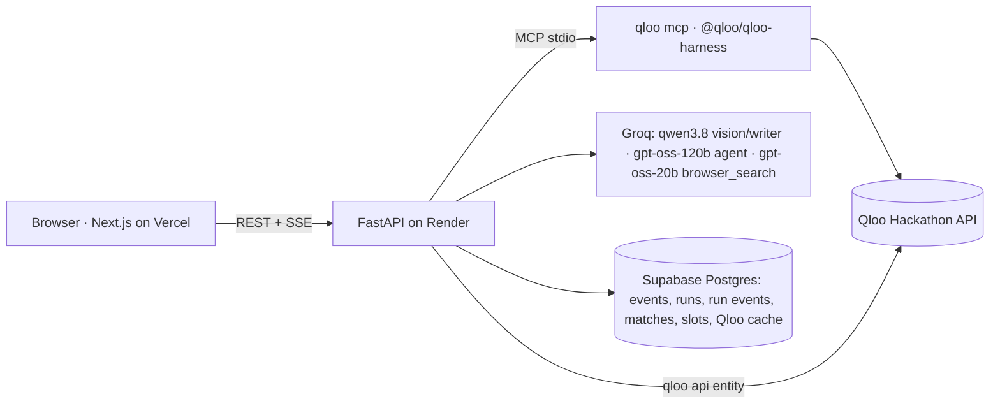

# Marquee

**Tell us about your event. Marquee tells you which brands to approach — and why your crowd already loves them.**

Sponsor discovery for events, powered by Qloo's taste graph. Built by **Team Enigma Trio** for the Qloo Agentic Hackathon.

- **Live demo:** _add your Vercel URL here_
- **Backend:** _add your Render URL here_ (`/health`)
- **License:** MIT

> **Demo portfolio:** a comedy night (Cedric the Entertainer, Steve Harvey, D.L. Hughley, Kevin Hart), a Los Angeles Dodgers watch party (Dodgers, Shohei Ohtani, Clayton Kershaw), an indie festival in Austin, and a Latin-pop arena tour.
>
> Demo scenario: fictional events with real performers, teams and brands as taste signals. Not affiliated with or endorsed by Live Nation or any performer, team or brand shown.

## The problem

Event hosts don't know which brands to approach. The usual advice is to copy whoever sponsored similar events, or to ask around. Meanwhile, sponsors increasingly want proof that an event's audience fits their brand.

**Incumbents ask "who sponsored events like yours?" Marquee asks "what does your crowd love?"** Only a cross-domain taste graph can answer that.

## What it does

1. **Understands the event** from a PDF deck, poster, website or plain text (Groq vision + text models). Every prefilled field is tagged with its source; sponsor logos on the materials become "Existing" sponsors.
2. **Matches the lineup in Qloo** (`qloo_describe`). Ambiguous names show candidates; nothing is guessed.
3. **Reads the crowd's taste** across music, TV, film, podcasts, books, games, brands and places (`qloo_recommend`, `qloo_audience_demographics`).
4. **Discovers brands** with a bounded Groq tool-calling agent that seeds Qloo brand recommendations from the crowd's *other* tastes (hidden gems), plus category-tag seeds for natural fits.
5. **Quantifies every match:** taste match (`qloo_rank`), audience overlap (`qloo_recommend` → `qloo_compare_audiences`), local strength (`qloo_where_popular`) and momentum (`qloo_trends`).
6. **Checks the web** for cited 2025–26 sponsorship activity (Groq `browser_search`).
7. **Delivers a ranked, explained, exportable shortlist** on three shelves: Natural fits, Hidden gems, Local heroes.

Plus:
- **Sponsor slots:** one brand per category, ranked head-to-head with `qloo_rank` (inbound brands typed by the host plus discovered brands), with "Why #1 over #2" in numbers and an honest "Too close to call" under 5 points.
- **Check a brand:** a quantified verdict for any inbound brand, compared side by side.
- **Ranking lenses:** re-weight the stored components instantly (no API calls). State lives in the URL.
- **Portfolio:** events × brands heat grid, the best property per brand, and under-sold categories.
- **Compare vs LLM-only:** the same brief to a plain LLM, shown next to Marquee's evidence.
- **Exports:** CSV and a print-ready PDF report.

## Architecture



- One long-lived `qloo mcp` session started in the FastAPI lifespan (`QLOO_API_KEY` forwarded via env, never logged). Bounded concurrency, retries only on `retryable`, auto-restart, and a `qloo exec` fallback.
- Every Qloo envelope is cached by `sha256(tool + normalised args)` in Postgres, plus a 200-entry in-memory LRU.
- Runs stream as Server-Sent Events. Every event is persisted (`RunEvent`), so a finished or interrupted run replays exactly.
- Groq calls use a per-model rolling token budget (free tier: about 8K tokens/minute), model fallback, a prompt cache and deterministic fallbacks, so the UI never shows invented text.

## Qloo tools used and why

| Tool | Used for |
|---|---|
| `qloo_describe` | Resolve performers and brands into Qloo entities; surface `needs_input` candidates |
| `qloo_recommend` | Crowd fingerprint per domain; brand discovery (crowd signals, category tags, and other-domain affinities); brand fans' artists; local places |
| `qloo_rank` | Taste match among all candidates; head-to-head ranking in sponsor slots; Check a brand |
| `qloo_compare_audiences` | Audience overlap: tags shared by the crowd and the brand's fans |
| `qloo_where_popular` | Local strength in the event city and national hotspots |
| `qloo_trends` | 12-month momentum (popularity percentile) |
| `qloo_audience_demographics` | Age and gender skew of the crowd (aggregate) |
| `qloo_find_tags` | Probe-time lookup of brand-category tag URNs used as discovery seeds |
| `qloo api entity` | Batch entity lookup for brand tags → category classification |

## Request → result walkthrough (SEAN Fest, redacted)

1. `qloo_describe {"entity": "Khruangbin", "type": "artist"}` → `ok`, entity `BAF6317A-…`, likewise for Japanese Breakfast, Mac DeMarco, Alvvays and Beach House.
2. `qloo_recommend {"target_type": "brand", "signals": [5 artist ids], "limit": 20}` → `ok`: Urban Outfitters, Dr. Martens, American Apparel, …
3. `qloo_rank {"options": [≤10 brand ids], "option_type": "brand", "signals": [...]}` in batches → taste rank among about 40 candidates.
4. `qloo_recommend {"target_type": "artist", "signals": ["<brand id>"]}` → the brand fans' artists, then `qloo_compare_audiences {"group_a": crowd, "group_b": fan artists}` → shared tags. For example, Urban Outfitters' fans share 8 of the crowd's top 20 tastes (Indie, Guitar, …).
5. `qloo_where_popular {"entity": "<id>", "within": "Austin, United States"}` → mean `affinity_rank` of the brand's top Austin areas → "Top 0.1% of areas".
6. Deterministic Marquee Fit → shelves → validated "why" bullets (each must contain a number and a known evidence id).

Recorded real envelopes live in `apps/api/tests/fixtures/qloo/`.

## Scoring

See [docs/SCORING.md](docs/SCORING.md). Fit = weighted mean of available components (taste 40, overlap 30, local 15, momentum 10, sponsor activity 5). Missing components are re-weighted and shown as "n/a". The language model never produces scores.

## Run locally

Prerequisites: Python 3.12 + [uv](https://docs.astral.sh/uv/), Node ≥ 22.19.

```bash
cd apps/api
cp .env.example .env        # fill in QLOO_API_KEY, GROQ_API_KEY, DATABASE_URL
npm install                 # installs @qloo/qloo-harness (the qloo CLI/MCP server)
uv sync
uv run python scripts/seed_samples.py     # runs the real pipeline for the 3 demo events
uv run uvicorn app.main:app --port 8010
```

```bash
cd apps/web
cp .env.example .env.local  # NEXT_PUBLIC_API_URL=http://localhost:8010
npm install
npm run dev -- -p 3010
```

Open http://localhost:3010. No Docker anywhere.

## Tests

```bash
cd apps/api && uv run pytest -q          # scoring, lens vectors, shelves, exclusions, validation, envelopes, cache
cd apps/web && node --experimental-strip-types tests/scoring.test.ts   # TS scorer matches the Python vectors
cd apps/web && npx tsc --noEmit && npm run build
```

## Deploy

See [docs/DEPLOY.md](docs/DEPLOY.md): Render native Python (Blueprint `render.yaml`, Node 22 auto-installed by `render-build.sh`) plus Vercel for `apps/web`.

## Known limitations

- Qloo results are **aggregate affinities**. They say nothing about any individual.
- Coverage varies by brand and city. Missing metrics show "n/a" and are re-weighted, never guessed.
- In the hackathon dataset, Qloo trend series are flat over the available window, so momentum shows "Flat" and is left out of the Fit.
- **Fit means audience alignment, not guaranteed ROI.**
- Web research uses public sources only and may miss private deals. A finding is kept only if its source appeared in the executed search.
- On Groq's free tier, writing steps can fall back to deterministic, number-backed templates when rate-limited.
- The sample events are fictional. The artists are used only as taste signals.

## License

MIT — see [LICENSE](LICENSE). Remember to set the license in the GitHub repo's About section.
